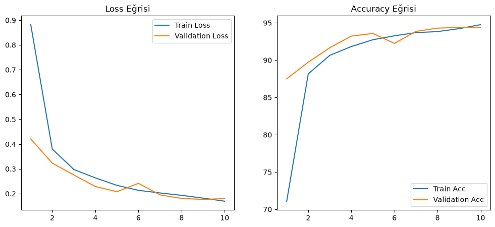
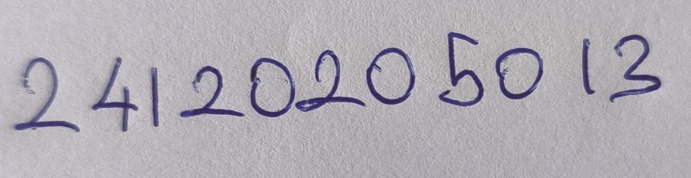
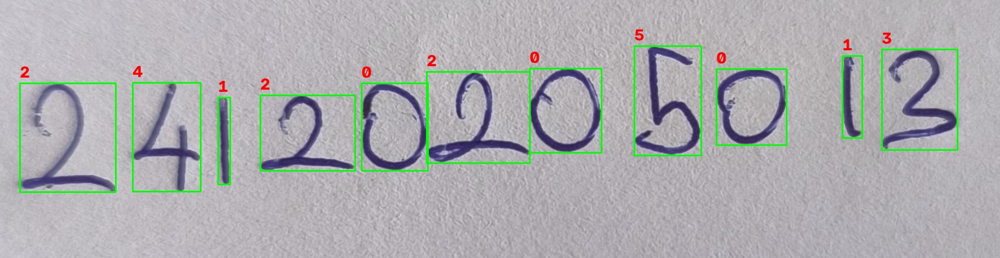
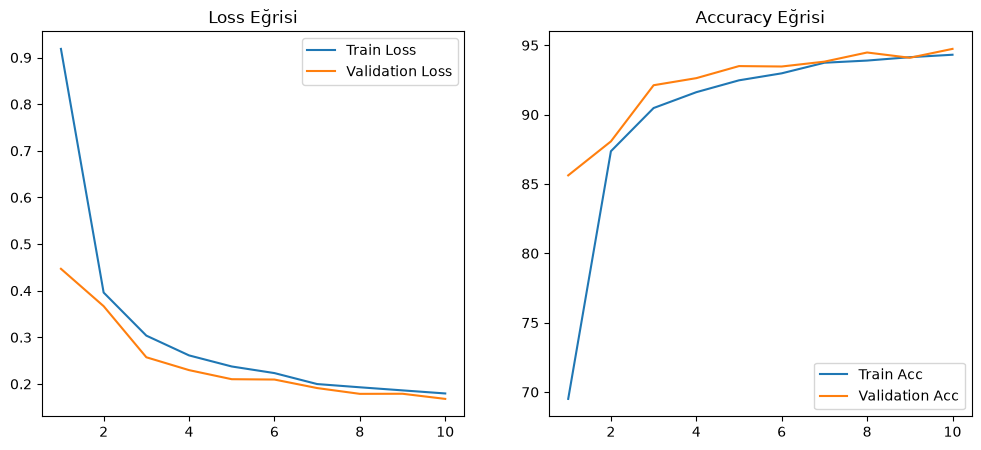
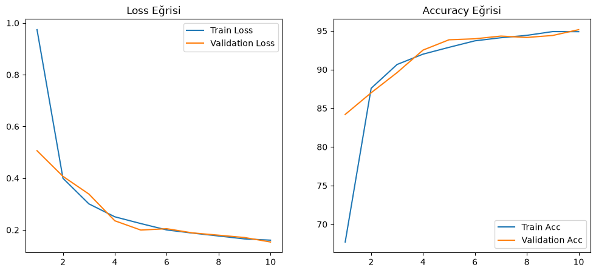

# MNIST Veri Seti ile MLP Tabanlı El Yazısı Rakam Tanıma

Bu proje, derin öğrenmenin temellerini uygulamalı olarak incelemek amacıyla PyTorch kullanılarak sıfırdan geliştirilmiş bir Multi-Layer Perceptron (MLP) modelini içermektedir. Proje kapsamında MNIST el yazısı veri seti ile bir model eğitilmiş, eğitilen model kendi el yazımla oluşturduğum gerçek dünya verileri üzerinde test edilerek "Distribution Shift" (Veri Dağılımı Kayması) kavramı analiz edilmiş ve farklı hiperparametre yapılandırmalarının etkileri karşılaştırılmıştır.

## 1. Proje Amacı ve Kapsamı

Bu çalışmanın temel hedefleri şunlardır:

* **Evrişimli Sinir Ağları (CNN) Olmadan Temel Ağ Kurulumu:** MNIST veri setini kullanarak salt MLP mimarisi kurmak.
* **Veri Bölümlendirme:** Veri setini Train, Validation ve Test olarak doğru şekilde ayırarak modelin genelleme yeteneğini ölçmek.
* **Optimizasyon ve Görselleştirme:** Hiperparametre optimizasyonu yapmak ve eğitim metriklerini (Loss, Accuracy) görselleştirerek yorumlamak.
* **Gerçek Dünya Uygulaması ve Distribution Shift:** Gerçek dünya verisi (kendi el yazım) ile eğitim verisi arasındaki dağılım farklılıklarını tespit edip, OpenCV ile görüntü ön işleme (preprocessing) yaparak bu sorunu çözmek.

## 2. Kullanılan Veri Seti

Projelerde standart olarak kabul gören **MNIST** veri seti kullanılmıştır.

* **Sınıf Sayısı:** 10 (0-9 arası rakamlar)
* **Boyut ve Format:** 28x28 piksel, Gri Tonlamalı (Grayscale)
* **Veri Ayrımı:** Modelin ezberlemesini (overfitting) önlemek amacıyla veriler şu şekilde ayrılmıştır:
  * **Eğitim (Train):** 50.000 görüntü
  * **Doğrulama (Validation):** 10.000 görüntü
  * **Test:** 10.000 görüntü (Geliştirme sürecinde kesinlikle kullanılmamış, sadece nihai değerlendirme için ayrılmıştır.)
* **Veri Artırma (Data Augmentation):** MLP'nin uzamsal kaymalara olan hassasiyetini azaltmak için `RandomAffine` ile eğitim verisine rastgele döndürme ve kaydırma işlemleri uygulanmıştır. Tüm veriler `[-1, 1]` aralığına normalize edilmiştir.

## 3. MLP Model Mimarisi

Hazır veya önceden eğitilmiş bir model (Pre-trained) kullanılmamış, model sıfırdan tasarlanmıştır.

* **Girdi Katmanı:** 784 Nöron (28x28 matris düzleştirilerek - *Flatten* - tek boyutlu tensöre çevrilmiştir)
* **Gizli Katman 1:** 256 Nöron (Aktivasyon: ReLU)
* **Gizli Katman 2:** 128 Nöron (Aktivasyon: ReLU)
* **Çıktı Katmanı:** 10 Nöron (10 farklı rakam sınıfını temsil eden ham logits değerleri)

## 4. Eğitim Süreci ve Hiperparametreler

Model, CUDA donanım hızlandırması kullanılarak eğitilmiştir.

* **Loss Fonksiyonu:** CrossEntropyLoss
* **Optimizer:** Adam
* **Learning Rate:** 0.001
* **Batch Size:** 64
* **Epoch Sayısı:** 10 (veya 25)

### Eğitim Sonuçları ve Başarı Metrikleri (Temel Model)
Orijinal modelimiz (Deney 1), 218.45 saniyelik eğitim süresi sonunda verileri ezberlemek (overfitting) yerine başarılı bir genelleme (generalization) sağlamıştır:

- **Training Loss:** ~0.1700
- **Validation Loss:** ~0.1800
- **Training Accuracy:** ~%94.80
- **Validation Accuracy:** ~%94.40
- **Test Accuracy:** %96.12

**Eğitim Süreci Loss ve Accuracy Grafiği:**
Aşağıdaki grafik, temel modelin eğitim ve doğrulama setlerindeki öğrenme performansını göstermektedir:

## 5. Gerçek Dünya Verisi ve Distribution Shift Analizi

Ödevin en kritik çıktısı olan "Training data ile gerçek dünya verisi arasındaki farkı gözlemleme" adımı başarıyla uygulanmıştır. Öğrenci numaramı oluşturan rakamlar beyaz kağıda yazılarak teker teker fotoğraflanmış ve kırpılmıştır.

**Distribution Shift (Veri Dağılımı Kayması) Problemi:**
Kendi el yazım siyah kalemle beyaz arka plan üzerindeydi. MNIST veri seti ise tam tersi (siyah arka plan üzerine beyaz, normalize edilmiş rakamlar) yapısındadır. Fotoğrafları doğrudan modele beslemek, %0 başarı ile sonuçlanacaktı.

**Çözüm: Görüntü Ön İşleme (Preprocessing) Pipeline'ı:**
Bu uçurumu kapatmak için OpenCV kütüphanesi ile bir boru hattı (pipeline) kurulmuştur:

1. **Renk Tersine Çevirme ve Thresholding (Otsu):** Görüntü siyah-beyaza zorlandı, arka plan siyah yapıldı.
2. **Kırpma (Bounding Box):** Gürültüler temizlenerek rakamın tam sınırları bulundu.
3. **Merkezleme (Centering) ve Yeniden Boyutlandırma:** Orijinal MNIST yapısına uygun olması için kırpılan her rakam 20x20 piksele boyutlandırıldı ve 28x28 piksellik siyah bir tuvalin tam merkezine oturtuldu.

**Sonuç:** Rakamları tek tek işleyip modele gönderdiğimizde, model yüksek bir doğrulukla rakamları tahmin etmeyi başardı. Bu sayede sadece bir model eğitmeyi değil, gerçek dünya verisini modele uygun hale getirecek mühendislik sürecini de kavramış oldum.

### Model Tahmin Örneği (Gerçek Dünya Verisi)

Aşağıda, kendi el yazımla oluşturduğum öğrenci numarama ait bir rakamın modele verilmeden önceki işlem adımları ve modelin nihai tahmini yer almaktadır:

1. **Orijinal Görüntü (Kağıt Üzerinde):**
 

2. **OpenCV Ön İşleme (MNIST Formatına Dönüştürülmüş):**

- **Gerçek Değer:** 24120205013
- **Modelin Tahminleri:** 2, 4, 1, 2, 0, 2, 0, 5, 0, 1, 3 (Tüm rakamlar başarılı)
- **Sonuç:** OpenCV ile uygulanan Bounding Box (sınır kutusu) algoritması tüm rakamları eksiksiz tespit etmiş ve MLP modelimiz dizideki her bir rakamı doğru sınıflandırarak gerçek dünya verisi üzerinde tam başarı sağlamıştır.

### Karşılaştırmalı Deney Grafikleri

**Deney 2 (3 Gizli Katmanlı Mimari):**

**Deney 3 (SGD Optimizer - Momentum 0.9):**

## 6. 📊 Hiperparametre ve Mimari Karşılaştırma Deneyleri

Ödev yönergeleri doğrultusunda, modelin farklı hiperparametreler ve mimariler altındaki performansını (Distribution/Generalization) ölçmek için 3 farklı deney gerçekleştirilmiştir. Tüm eğitim süreçleri CUDA donanım hızlandırması ile 10 Epoch üzerinden test edilmiştir.

| Deney | Model Mimarisi | Optimizer | Öğrenme Oranı | Eğitim Süresi | Test Başarısı |
| :--- | :--- | :--- | :--- | :--- | :--- |
| **Deney 1 (Temel Model)** | 2 Gizli Katman (256 -> 128) | Adam | 0.001 | 218.45 sn | %96.12 |
| **Deney 2 (Derin Mimari)** | 3 Gizli Katman (256 -> 128 -> 64)| Adam | 0.001 | 214.37 sn | %94.82 |
| **Deney 3 (Fark. Optimizer)**| 2 Gizli Katman (256 -> 128) | SGD (Moment: 0.9)| 0.01 | 208.65 sn | %95.71 |

*(Not: Geliştirme sürecine ait doğruluk ve kayıp grafikleri proje dizinindeki `graph_results` klasöründe yer almaktadır.)*

### Sonuç Analizi ve Mühendislik Değerlendirmesi
1. **Model Derinliğinin Etkisi (Deney 1 vs Deney 2):** 
Gizli katman sayısını 2'den 3'e çıkarmak (araya 64 nöronluk yeni bir katman eklemek) test başarısını artırmak yerine %94.82'ye düşürmüştür. Bu durum, MNIST gibi 28x28 boyutlarında nispeten basit uzamsal özelliklere sahip bir veri setinde model kapasitesini (parametre sayısını) gereğinden fazla artırmanın ezberlemeye (overfitting) yol açabileceğini kanıtlamaktadır. 

2. **Optimizasyon Algoritmalarının Etkisi (Adam vs SGD):** 
Deney 3'te Adam yerine Klasik SGD (Stochastic Gradient Descent) kullanılmıştır. SGD'nin yavaş yakınsama dezavantajını kırmak için `0.9` oranında Momentum parametresi eklenmiştir. Sonuç olarak SGD, Adam'a oldukça yakın (%95.71) bir genelleme başarısı sergilemiş ve matris çarpım operasyonlarındaki sadeliği sayesinde donanımsal olarak en kısa eğitim süresine (208.65 sn) imza atmıştır.
